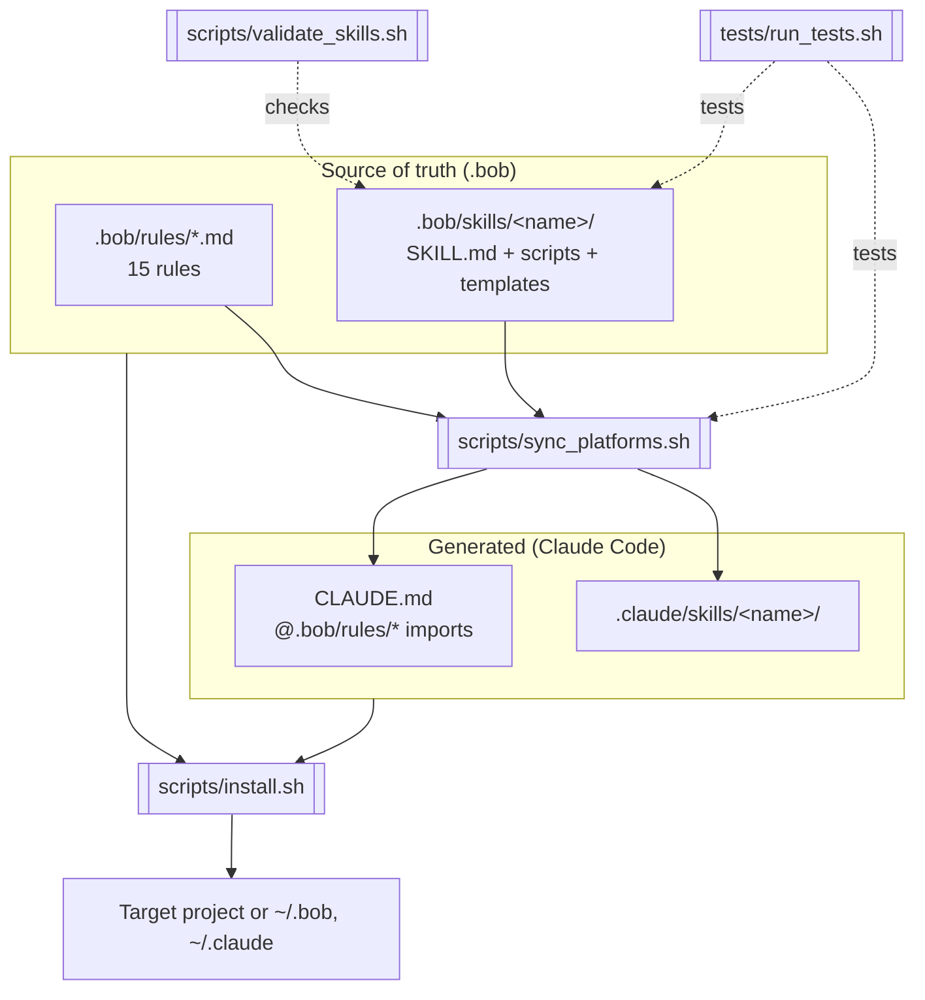
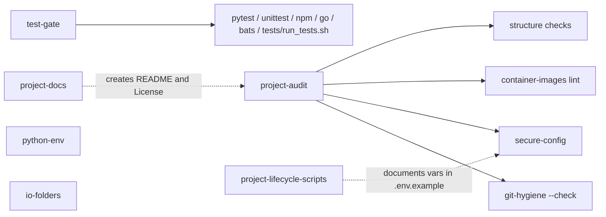
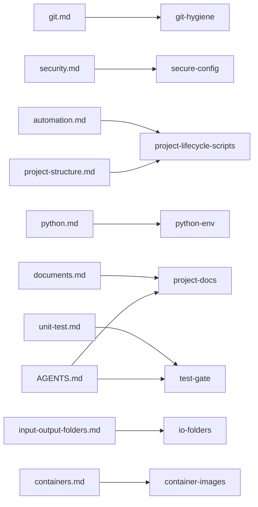

# Architecture

## Source of truth and generated outputs

## Skill composition

## Rule to skill mapping

## Design decisions
- **Rules say what, skills say how.** Rules stay tiny and always loaded; procedures load on demand, which reduces context cost.
- **Same `SKILL.md` format on both platforms** (frontmatter `name` + `description`, folder name equals `name`). No conversion needed, only a copy.
- **Rules reach Claude Code through `CLAUDE.md` `@` imports**, so there is no duplicated text to drift.
- **Skill scripts are plain Bash 3.2-compatible**, with exit codes, so they work on macOS and in any agent.
- **Idempotent and non-destructive**: scaffolders never overwrite existing files unless `--force` (project rule: update, don't recreate).
