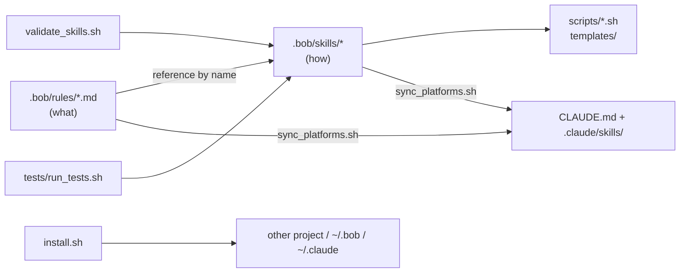
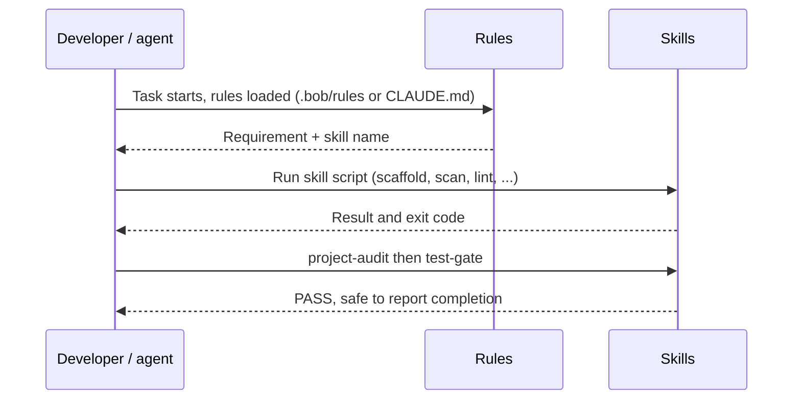
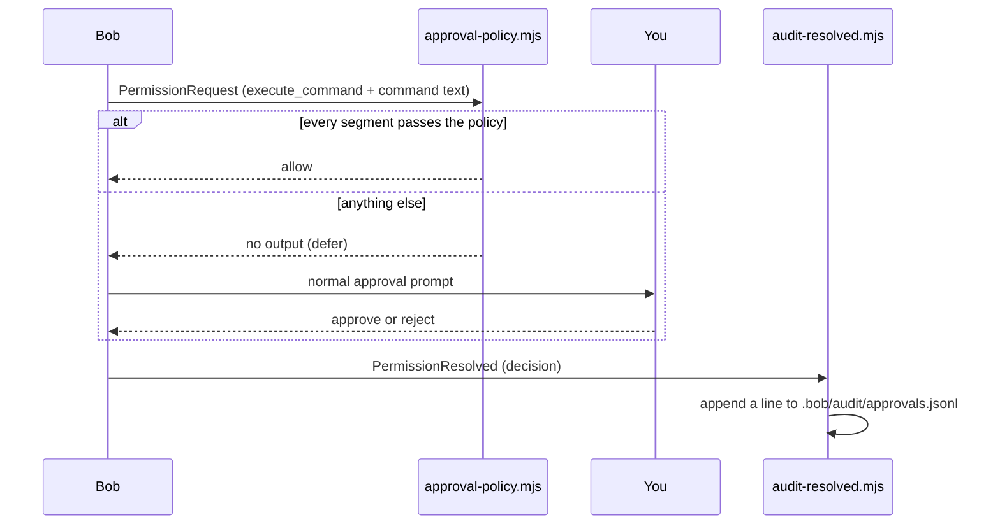

# Rule Enhancer

Optimized, de-duplicated project rules plus nine reusable, tested **skills** that work in both **IBM Bob** and **Claude Code**.
`.bob/` is the single source of truth; the Claude Code layout (`CLAUDE.md`, `.claude/skills/`) is generated from it.

**Status:** the 15 rules in `.bob/rules/` were refactored in place (same filenames, so existing references keep working) and 9 skills were added. A task [auto-approval system](#auto-approval-system) (two Bob hooks) was added for Bob only. All 122 checks in `tests/run_tests.sh` pass (0 failures), verified on macOS with Bash 3.2 and Node 24 only. The Claude Code output has not been tested in a live Claude Code session. See [Current status](#current-status).

## What you get

| Piece | Location | Purpose |
|---|---|---|
| 15 refactored rules | `.bob/rules/*.md` | Short, one-owner-per-topic statements of *what* must hold |
| 9 skills | `.bob/skills/<name>/` | Tested scripts + `SKILL.md` describing *how* (inputs, outputs, usage) |
| Claude Code layout | `CLAUDE.md`, `.claude/skills/` | Generated by `scripts/sync_platforms.sh` |
| Auto-approval hooks | `.bob/hooks/`, `.bob/settings.json` | Bob-only: auto-answers routine read-only commands, audits every approval outcome |
| Tooling | `scripts/` | validate, sync, install (`--platform bob\|claude\|both`) |
| Tests | `tests/run_tests.sh`, `tests/policy.test.mjs` | 122 checks, 0 failures; the policy decision table (64 cases) runs as one of them. The shell suite needs no dependencies; the hook tests need Node |
| Original rules backup | `output/<timestamp>/original-rules/` | Unmodified copy (content is git-ignored) |

## Architecture



## Workflow



## Skills

| Skill | Replaces rule text in | Script(s) |
|---|---|---|
| `git-hygiene` | git.md, mode-change.md | `ensure_gitignore.sh` |
| `secure-config` | security.md | `scan_secrets.sh` |
| `project-lifecycle-scripts` | automation.md, project-structure.md, macos.md | `scaffold_scripts.sh` + start/stop/cleanup/cleanup-images templates |
| `project-docs` | documents.md, AGENTS.md (license) | `scaffold_docs.sh` |
| `python-env` | python.md | `setup_env.sh` |
| `io-folders` | input-output-folders.md | `io.sh` |
| `container-images` | containers.md | `lint_containerfile.sh`, `Containerfile` template |
| `test-gate` | unit-test.md, AGENTS.md | `run_tests.sh` |
| `project-audit` | composes the above | `audit.sh` |

Details: [Docs/Skills.md](Docs/Skills.md). What changed and why: [Docs/Optimization-Report.md](Docs/Optimization-Report.md).

Skills follow the shared `SKILL.md` format (frontmatter `name` + `description`, folder name equals `name`), checked against the Bob documentation and the Claude Code `SKILL.md` convention and enforced by `scripts/validate_skills.sh`.

## Auto-Approval System

Bob asks for approval before every `execute_command`. Two lifecycle hooks, wired in [`.bob/settings.json`](.bob/settings.json), remove the prompts for routine read-only work and keep a record of every decision. **Bob only**: Claude Code does not read `.bob/settings.json`, so none of this applies there.



| Piece | Role |
|---|---|
| [`.bob/settings.json`](.bob/settings.json) | Registers the hooks only: `PermissionRequest` (matcher `^execute_command$`) runs `approval-policy.mjs`; `PermissionResolved` runs `audit-resolved.mjs`; timeout 10 s each. It holds **no policy rules** |
| [`.bob/hooks/approval-policy.mjs`](.bob/hooks/approval-policy.mjs) | The policy. It can only **allow** or stay silent; it never denies, so the normal prompt remains the fallback. Always exits 0 |
| [`.bob/hooks/audit-resolved.mjs`](.bob/hooks/audit-resolved.mjs) | Appends one JSON line (time, session, tool, decision, input) per approval outcome to `.bob/audit/approvals.jsonl`. Never decides; fails open if the log cannot be written |
| [`tests/policy.test.mjs`](tests/policy.test.mjs) | Decision table for the policy (64 cases: routine, important, adversarial, hardening). Also run by `tests/run_tests.sh`, together with checks of the audit hook and `settings.json` |

**What the policy allows:** a command is answered only when it is at most 400 characters and has at most 6 segments (split on `|`, `||`, `&&`, `;`, `&`, newline), the working directory exists, and **every** segment starts with an allow-listed prefix (read-only git, `ls`, `cat`, `grep`, test and build commands such as `npm test`, `pytest`, `mvn test`, `make test`, and similar).
**What always keeps the prompt:** writes and redirects (`>`, `tee`, `rm`, `mv`, `touch`), network tools (`curl`, `ssh`), `sudo`, `git push` and `git commit`, command or process substitution, options that execute or write (`--output`, `-exec`, `--ext-diff`, `--pre`), reads of credentials and env files (`.env`, `.ssh`, `secrets`, `~/.bob`, `/etc`), and globs or recursive searches that could reach them.

Configure it in [Docs/Quickstart.md](Docs/Quickstart.md#configuring-task-auto-approval). This is a convenience filter, not a security boundary: a prefix list cannot prove an arbitrary shell command safe. The audit log contains full command text, so `.bob/audit/` is git-ignored.

## Quick start

```bash
scripts/validate_skills.sh          # check skill format
scripts/sync_platforms.sh           # (re)generate CLAUDE.md and .claude/skills
tests/run_tests.sh                  # run the test suite
scripts/install.sh --target ~/Devs/my-project --platform both   # bob | claude | both (default)
```

`install.sh --platform` options:

| Value | Installs into the target |
|---|---|
| `bob` | `.bob/rules/` and `.bob/skills/` |
| `claude` | `.claude/skills/` and `CLAUDE.md`, plus `.bob/rules/` because `CLAUDE.md` imports each rule with `@.bob/rules/<file>` |
| `both` (default) | Everything above |

With `--global`, only skills are installed (to `~/.bob/skills` and/or `~/.claude/skills`); rules are project-specific and skipped.

More in [Docs/Quickstart.md](Docs/Quickstart.md) and [Docs/Architecture.md](Docs/Architecture.md).

## Current status

| Area | State |
|---|---|
| Tests | 122 passed, 0 failed (`tests/run_tests.sh`, includes the 64-case `tests/policy.test.mjs` table) |
| Test environment | macOS, Bash 3.2, Node 24 only |
| Auto-approval hooks | Policy and audit hook tested with scripted events. The audit log shows `PermissionResolved` firing during Bob sessions in this workspace; the `allow` path through Bob's approval UI was not observed end to end |
| Skill validation | 9 of 9 valid (`scripts/validate_skills.sh`) |
| Claude Code output | Generated and in sync (`sync_platforms.sh --check`), **not yet tested in a live Claude Code session** |
| Architecture diagrams | All 3 in `Docs/Architecture.md` render with the Mermaid CLI |

## Known issues and fixes

- **Fixed: `scan_secrets.sh` always exited 0.** Its `report()` function was fed through a pipeline, which runs in a subshell, so the `FOUND` flag was lost and the scanner could never report a failure. `report` now runs in the main shell via process substitution (`report "label" < <(grep ...)`). The test suite found this and covers it.
- **Fixed: "Skill composition" Mermaid error** in `Docs/Architecture.md`. Dotted edges written as `-. text .->` made the parser fail with a lexical error when the text contained `.env.example`. Edges now use `-.->|"label"|`, node labels are quoted, and node IDs containing dots (such as `git.md`) were replaced with safe IDs.
- **Fixed: auto-approval policy let unsafe commands through.** Probing while documenting the hooks showed these were auto-allowed: `ls & node evil.js` (`&` was not a segment separator), `cat <(...)`, `awk` and `jq` programs that run commands, `git branch -D`, `make deploy`, `git diff --ext-diff`, `rg --pre=sh`, `sed -n '1e ...'`, `uniq in out` (writes a file), and secret reads through `cat .e*`, `cat .e''nv`, `cat {.env,x}`, `cat secrets.yaml` and `grep -r`. All now keep the prompt, with a test case for each.
- **Open: `install.sh` does not copy `.bob/hooks/` or `.bob/settings.json`** to other projects (copying settings would overwrite the target's own). Copy the hooks by hand and merge the `hooks` block; see the [Quickstart](Docs/Quickstart.md#configuring-task-auto-approval).
- **Open: llama.cpp port conflict** in `.bob/rules/local-llm.md` (8080 vs the 9931 base URL). Verify which is live.
- **Limits:** `secure-config` is a regex scanner, and `test-gate` detects untested modules for Python only. See [Docs/Optimization-Report.md](Docs/Optimization-Report.md).

## License

MIT
