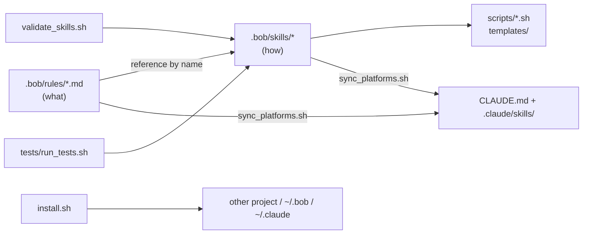
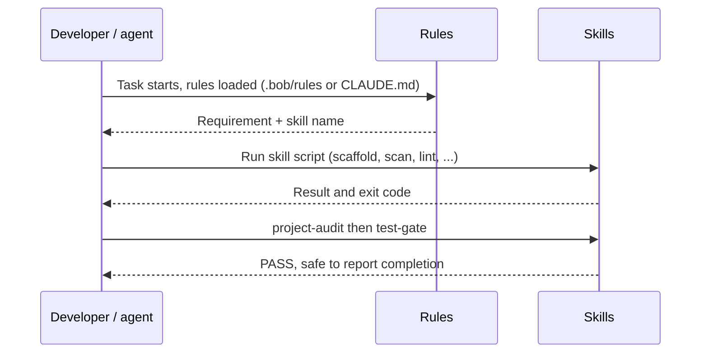

# Rule Enhancer

Optimized, de-duplicated project rules plus nine reusable, tested **skills** that work in both **IBM Bob** and **Claude Code**.
`.bob/` is the single source of truth; the Claude Code layout (`CLAUDE.md`, `.claude/skills/`) is generated from it.

## What you get

| Piece | Location | Purpose |
|---|---|---|
| 15 refactored rules | `.bob/rules/*.md` | Short, one-owner-per-topic statements of *what* must hold |
| 9 skills | `.bob/skills/<name>/` | Tested scripts + `SKILL.md` describing *how* (inputs, outputs, usage) |
| Claude Code layout | `CLAUDE.md`, `.claude/skills/` | Generated by `scripts/sync_platforms.sh` |
| Tooling | `scripts/` | validate, sync, install |
| Tests | `tests/run_tests.sh` | 110 assertions, no external dependencies |
| Original rules backup | `output/<timestamp>/original-rules/` | Unmodified copy (content is git-ignored) |

## Architecture



## Workflow



## Skills

| Skill | Replaces rule text in | Script(s) |
|---|---|---|
| `git-hygiene` | git.md, mode-change.md | `ensure_gitignore.sh` |
| `secure-config` | security.md | `scan_secrets.sh` |
| `project-lifecycle-scripts` | automation.md, project-structure.md, macos.md | `scaffold_scripts.sh` + start/stop/cleanup/cleanup-images templates |
| `project-docs` | documents.md, AGENTS.md (license) | `scaffold_docs.sh` |
| `python-env` | python.md | `setup_env.sh` |
| `io-folders` | input-output-folders.md | `io.sh` |
| `container-images` | containers.md | `lint_containerfile.sh`, `Containerfile` template |
| `test-gate` | unit-test.md, AGENTS.md | `run_tests.sh` |
| `project-audit` | composes the above | `audit.sh` |

Details: [Docs/Skills.md](Docs/Skills.md). What changed and why: [Docs/Optimization-Report.md](Docs/Optimization-Report.md).

## Quick start

```bash
scripts/validate_skills.sh          # check skill format
scripts/sync_platforms.sh           # (re)generate CLAUDE.md and .claude/skills
tests/run_tests.sh                  # run the test suite
scripts/install.sh --target ~/Devs/my-project --platform both
```

More in [Docs/Quickstart.md](Docs/Quickstart.md) and [Docs/Architecture.md](Docs/Architecture.md).

## License

MIT
