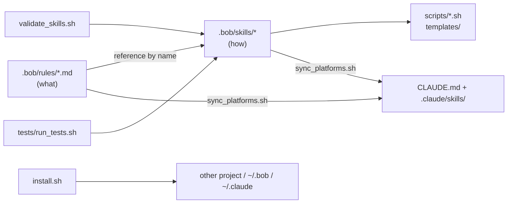
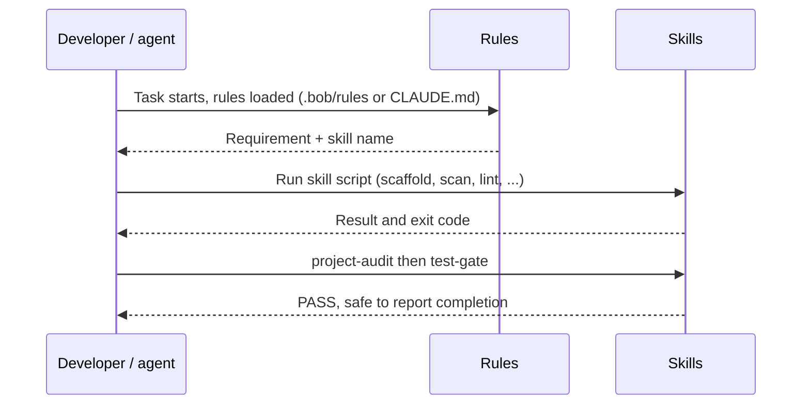

# Rule Enhancer

Optimized, de-duplicated project rules plus nine reusable, tested **skills** that work in both **IBM Bob** and **Claude Code**.
`.bob/` is the single source of truth; the Claude Code layout (`CLAUDE.md`, `.claude/skills/`) is generated from it.

**Status:** the 15 rules in `.bob/rules/` were refactored in place (same filenames, so existing references keep working) and 9 skills were added. All 110 tests pass (0 failures), verified on macOS with Bash 3.2 only. The Claude Code output has not been tested in a live Claude Code session. See [Current status](#current-status).

## What you get

| Piece | Location | Purpose |
|---|---|---|
| 15 refactored rules | `.bob/rules/*.md` | Short, one-owner-per-topic statements of *what* must hold |
| 9 skills | `.bob/skills/<name>/` | Tested scripts + `SKILL.md` describing *how* (inputs, outputs, usage) |
| Claude Code layout | `CLAUDE.md`, `.claude/skills/` | Generated by `scripts/sync_platforms.sh` |
| Tooling | `scripts/` | validate, sync, install (`--platform bob\|claude\|both`) |
| Tests | `tests/run_tests.sh` | 110 assertions, no external dependencies; 0 failures |
| Original rules backup | `output/<timestamp>/original-rules/` | Unmodified copy (content is git-ignored) |

## Architecture



## Workflow



## Skills

| Skill | Replaces rule text in | Script(s) |
|---|---|---|
| `git-hygiene` | git.md, mode-change.md | `ensure_gitignore.sh` |
| `secure-config` | security.md | `scan_secrets.sh` |
| `project-lifecycle-scripts` | automation.md, project-structure.md, macos.md | `scaffold_scripts.sh` + start/stop/cleanup/cleanup-images templates |
| `project-docs` | documents.md, AGENTS.md (license) | `scaffold_docs.sh` |
| `python-env` | python.md | `setup_env.sh` |
| `io-folders` | input-output-folders.md | `io.sh` |
| `container-images` | containers.md | `lint_containerfile.sh`, `Containerfile` template |
| `test-gate` | unit-test.md, AGENTS.md | `run_tests.sh` |
| `project-audit` | composes the above | `audit.sh` |

Details: [Docs/Skills.md](Docs/Skills.md). What changed and why: [Docs/Optimization-Report.md](Docs/Optimization-Report.md).

Skills follow the shared `SKILL.md` format (frontmatter `name` + `description`, folder name equals `name`), checked against the Bob documentation and the Claude Code `SKILL.md` convention and enforced by `scripts/validate_skills.sh`.

## Quick start

```bash
scripts/validate_skills.sh          # check skill format
scripts/sync_platforms.sh           # (re)generate CLAUDE.md and .claude/skills
tests/run_tests.sh                  # run the test suite
scripts/install.sh --target ~/Devs/my-project --platform both   # bob | claude | both (default)
```

`install.sh --platform` options:

| Value | Installs into the target |
|---|---|
| `bob` | `.bob/rules/` and `.bob/skills/` |
| `claude` | `.claude/skills/` and `CLAUDE.md`, plus `.bob/rules/` because `CLAUDE.md` imports each rule with `@.bob/rules/<file>` |
| `both` (default) | Everything above |

With `--global`, only skills are installed (to `~/.bob/skills` and/or `~/.claude/skills`); rules are project-specific and skipped.

More in [Docs/Quickstart.md](Docs/Quickstart.md) and [Docs/Architecture.md](Docs/Architecture.md).

## Current status

| Area | State |
|---|---|
| Tests | 110 passed, 0 failed (`tests/run_tests.sh`) |
| Test environment | macOS, Bash 3.2 only |
| Skill validation | 9 of 9 valid (`scripts/validate_skills.sh`) |
| Claude Code output | Generated and in sync (`sync_platforms.sh --check`), **not yet tested in a live Claude Code session** |
| Architecture diagrams | All 3 in `Docs/Architecture.md` render with the Mermaid CLI |

## Known issues and fixes

- **Fixed: `scan_secrets.sh` always exited 0.** Its `report()` function was fed through a pipeline, which runs in a subshell, so the `FOUND` flag was lost and the scanner could never report a failure. `report` now runs in the main shell via process substitution (`report "label" < <(grep ...)`). The test suite found this and covers it.
- **Fixed: "Skill composition" Mermaid error** in `Docs/Architecture.md`. Dotted edges written as `-. text .->` made the parser fail with a lexical error when the text contained `.env.example`. Edges now use `-.->|"label"|`, node labels are quoted, and node IDs containing dots (such as `git.md`) were replaced with safe IDs.
- **Open: llama.cpp port conflict** in `.bob/rules/local-llm.md` (8080 vs the 9931 base URL). Verify which is live.
- **Limits:** `secure-config` is a regex scanner, and `test-gate` detects untested modules for Python only. See [Docs/Optimization-Report.md](Docs/Optimization-Report.md).

## License

MIT
